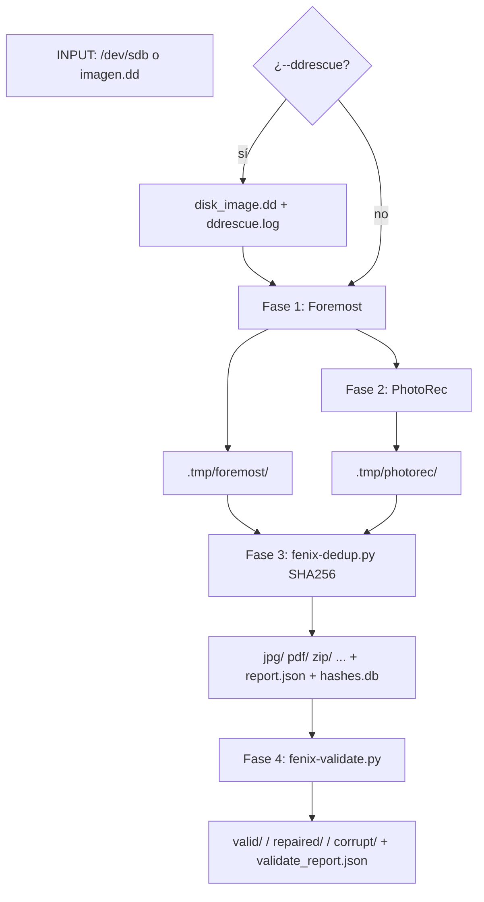

# fenix-recover

Super script de recuperación de datos que fusiona Foremost y PhotoRec en una sola pasada con salida única, deduplicación por SHA256 y validación/reparación automática de archivos recuperados.

[](https://python.org)
[](https://www.gnu.org/software/bash/)
[](https://github.com/bi0punk/fenix-recover/actions)
[](LICENSE)

## Contenido

- [Características](#características)
- [Arquitectura](#arquitectura)
- [Stack](#stack)
- [Estructura del repositorio](#estructura-del-repositorio)
- [Instalación](#instalación)
- [Uso](#uso)
- [Flags](#flags)
- [Estructura de salida](#estructura-de-salida)
- [Advertencias](#advertencias)
- [Tests / CI](#tests--ci)
- [Licencia](#licencia)

## Características

- **Foremost** — carvado rápido a un directorio temporal
- **PhotoRec** — carvado profundo con deduplicación automática contra Foremost
- **Deduplicación** — salida única por tipo (`jpg/`, `pdf/`, ...) con nombres `F_NNNNNN.ext` / `P_NNNNNN.ext`, hashes SHA256 en base SQLite
- **Validación** — clasifica archivos en `valid/`, `repaired/`, `corrupt/` según tipo (JPEG, PNG, MP4, ZIP, PDF, documentos, texto...)
- **Reparación** — intenta reparar JPEG truncado, remux MP4 y reparar ZIP (`zip -F`)
- **ddrescue opcional** — creación de imagen antes de tallar
- **Reporte JSON** de dedup y validación
- **Configurable** vía flags o archivo `fenix-recover.conf`

## Arquitectura



Flujo: las fases de carvado (Foremost y PhotoRec) generan archivos en `.tmp/`; la deduplicación copia a una salida única por tipo evitando duplicados entre ambas herramientas; la validación clasifica y repara lo recuperado.

## Stack

| Componente | Tecnología |
|---|---|
| Orquestación | Bash (`fenix-recover.sh`) |
| Carvado | Foremost + PhotoRec (testdisk) |
| Dedup | Python (`fenix-dedup.py`) + SQLite |
| Validación | Python (`fenix-validate.py`) + Pillow |
| Imagen | ddrescue (opcional) |
| CI | Ruff + pytest (GitHub Actions) |

## Estructura del repositorio

```
fenix-recover/
├── fenix-recover.sh        # Orquestador principal (Bash)
├── fenix-dedup.py          # Deduplicación y copia a salida única
├── fenix-validate.py       # Validación y reparación de archivos
├── fenix-recover.conf      # Configuración por defecto
├── VERSION
├── tests/
│   ├── test_dedup.py
│   └── test_validate.py
├── requirements.txt        # Pillow
├── pyproject.toml
├── .github/workflows/ci.yml
└── README.md
```

## Instalación

### Requisitos

- Linux (Debian/Ubuntu, Arch, etc.)
- `foremost`, `photorec` (testdisk), `python3`
- `ddrescue` (opcional, para crear imagen antes de tallar)
- Pillow (`pip install -r requirements.txt`)

```bash
sudo apt-get install foremost testdisk python3 ddrescue
pip install -r requirements.txt
```

## Uso

```bash
# Modo interactivo (elige dispositivo de un menú)
sudo ./fenix-recover.sh

# Batch con dispositivo
sudo ./fenix-recover.sh -i /dev/sdb -o ~/recuperado

# Batch con imagen .dd
./fenix-recover.sh -i imagen.dd -o ~/recuperado

# Solo ciertos tipos de archivo
sudo ./fenix-recover.sh -i /dev/sdb -o ~/recuperado -t jpg,pdf,zip

# Crear imagen con ddrescue primero (seguro)
sudo ./fenix-recover.sh -i /dev/sdb --ddrescue

# Solo validar una salida existente
./fenix-recover.sh --validate-only -o ~/recuperado
```

## Flags

| Flag | Descripción |
|------|-------------|
| `-i` | Dispositivo (`/dev/sdb`) o imagen (`imagen.dd`) |
| `-o` | Directorio de salida |
| `-t` | Tipos de archivo separados por coma (default: todos) |
| `--foremost-only` | Solo ejecutar Foremost |
| `--photorec-only` | Solo ejecutar PhotoRec |
| `--ddrescue` | Crear imagen con ddrescue antes de tallar |
| `--no-validate` | Skip validación de archivos |
| `--validate-only` | Solo validar salida existente |
| `-q` | Modo silencioso |

## Estructura de salida

```
recovery_20260721_1430/
├── jpg/                # Archivos únicos (F_ de Foremost, P_ de PhotoRec)
│   ├── F_00000001.jpg
│   ├── F_00000002.jpg
│   ├── P_00000001.jpg   ← solo si PhotoRec encontró algo único
│   └── ...
├── pdf/
├── zip/
├── unknown/
├── ...                 # otros tipos según lo recuperado
│
├── valid/              # Copia de archivos que pasaron validación
│   ├── jpg/
│   ├── pdf/
│   └── ...
├── repaired/           # Archivos corruptos que se pudieron reparar
│   └── jpg/
├── corrupt/            # Archivos corruptos sin reparación
│   └── jpg/
│
├── report.json         # Stats de dedup
├── validate_report.json# Stats de validación
├── hashes.db           # SQLite con SHA256
├── disk_image.dd       # (si se usó --ddrescue)
├── ddrescue.log
└── .tmp/               # Se elimina automáticamente al final
```

## Advertencias

- Siempre recuperar a un disco **diferente** del que contiene los datos perdidos
- Los nombres originales de archivo NO se pueden recuperar (el carvado ignora el filesystem)
- Para corrupción severa, usar `--ddrescue` primero
- Este script no modificará el dispositivo de origen

## Tests / CI

CI: GitHub Actions ejecuta lint (Ruff) y tests (pytest) en cada push/PR.

```bash
pip install pytest ruff
pytest -q
ruff check .
```

## Licencia

MIT — ver [LICENSE](LICENSE).